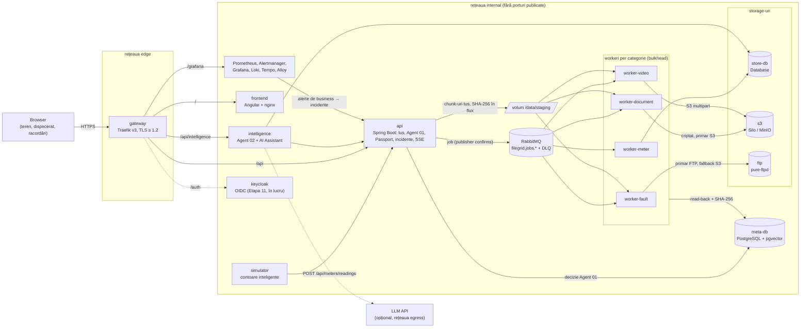

# FileGrid PPC

Punctul unic de intrare pentru fișierele operaționale ale unui operator de distribuție a energiei electrice: citiri de contoare, înregistrări de avarie, documente de racordare și video-uri de inspecție cu drona. FileGrid decide, pe baza unei politici per categorie, în ce storage (FTP, S3 sau Database) ajunge fiecare fișier, îi verifică integritatea și măsoară tot ce se întâmplă.

Arhitectura este descrisă în [docs/ARCHITECTURE.md](docs/ARCHITECTURE.md), deciziile importante în [docs/ADR/](docs/ADR/), maparea cerințelor pe implementare în [docs/COMPLIANCE.md](docs/COMPLIANCE.md), iar progresul pe etape în [docs/CHANGELOG-ETAPE.md](docs/CHANGELOG-ETAPE.md).

## Arhitectura pe scurt



Liniile punctate sunt opționale sau în lucru. Fluxul detaliat al unui fișier este în [docs/ARCHITECTURE.md](docs/ARCHITECTURE.md) §A.2.

> **Stadiu:** Etapa 5 — upload reluabil (tus) cu cozi per categorie, transfer verificat prin read-back SHA-256, fallback și reluare automată (Etapa 4), plus simulatorul de contoare cu ingestie fără pierderi și fără dubluri (Etapa 5). Frontend-ul vine din Etapa 10.

## Cerințe preliminare

| Unealtă | Obligatoriu | Note |
| --- | --- | --- |
| Docker Desktop (sau Docker Engine + Compose v2) | da | **Docker Engine 29 sau mai nou**; minimum 6 GB RAM alocați (mod lite), 8 GB recomandat (mod full); vezi „Resurse” |
| Git | da | pe Windows include și Git Bash |
| mkcert | nu | dacă există, certificatul local e de încredere în browser (`mkcert -install` o singură dată); altfel se generează unul self-signed |
| make | nu | doar pentru scurtăturile din `Makefile` |
| JDK 21 | doar pentru teste | necesar pentru `./mvnw verify`; pornirea sistemului nu are nevoie de el (backend-ul se compilează în Docker) |

Testele de integrare folosesc Testcontainers, fixat la versiunea 1.21.4 — prima care poate vorbi cu Docker Engine 29 (care acceptă doar API 1.44+). De aici cerința de versiune pentru Docker.

### Windows: unde ții proiectul

Recomandat: clonează repository-ul în sistemul de fișiere WSL (de exemplu `~/filegrid`, dintr-un terminal Ubuntu) și deschide-l cu VS Code prin extensia **Remote - WSL**. Docker Desktop rulează containerele în WSL, iar un proiect ținut pe un disc Windows (`C:\`, `D:\`) ajunge în containere printr-un strat de traducere între cele două sisteme de fișiere. Consecințe pe discul Windows:

- notificările de modificare a fișierelor nu ajung în containere, deci serviciile nu observă singure o configurație schimbată (de aceea există `scripts/reload-config.sh`);
- accesul la fișiere este mult mai lent (build-uri, `node_modules`);
- terminațiile de linie și drepturile de execuție ale scripturilor se pot strica.

Proiectul funcționează și de pe un disc Windows; în acest caz, evită folderele sincronizate (OneDrive).

## Pornire cu o singură comandă

```bash
./start.sh          # Linux, macOS, Git Bash, WSL
```

```powershell
.\start.ps1         # Windows PowerShell (nu are nevoie de bash)
```

Scriptul face, în ordine:

1. `scripts/init-env.sh` — creează `.env` din `.env.example`, cu parole aleatorii puternice. Un `.env` existent nu este suprascris niciodată; se adaugă doar variabilele care lipsesc.
2. `scripts/gen-certs.sh` — generează certificatul TLS local în `infra/certs/` (mkcert dacă există, altfel openssl self-signed).
3. `docker compose up -d --build`
4. așteaptă până când toate serviciile sunt `healthy`, apoi afișează URL-urile.

Gateway-ul publică HTTPS pe 443 și HTTP pe 8080 (HTTP doar redirecționează către HTTPS; 8080 este implicit pentru că portul 80 e adesea ocupat pe Windows). Dacă un port este deja folosit pe mașină, schimbă `GATEWAY_HTTP_PORT` / `GATEWAY_HTTPS_PORT` în `.env` și rulează din nou scriptul.

### Mod full și mod lite

| Mod | Comandă | Workeri |
| --- | --- | --- |
| full (implicit) | `./start.sh`, `.\start.ps1`, `make up` | câte un worker per categorie (necesar pentru demo-ul de bulkhead) |
| lite | `./start.sh --lite`, `.\start.ps1 --lite`, `make up-lite` | un singur `worker-all`, pentru toate categoriile |

Scriptul de pornire oprește workerii celuilalt mod, deci poți trece oricând dintr-unul în altul rulându-l din nou. Comenzile `docker compose` date de mână folosesc modul din `COMPOSE_PROFILES` (fișierul de mediu), implicit `full`.

## Resurse

| Mod | Memorie alocată lui Docker |
| --- | --- |
| lite | minimum 6 GB |
| full + demo | 8 GB recomandat |

Fiecare serviciu are o limită de memorie în `infra/docker-compose.yml` (`deploy.resources.limits.memory`). Pentru backend, limita și dimensiunile JVM sunt explicite și se schimbă din fișierul de mediu: `API_MEMORY_LIMIT` / `API_JAVA_OPTS`, `WORKER_MEMORY_LIMIT` / `WORKER_JAVA_OPTS`, `WORKER_VIDEO_MEMORY_LIMIT` / `WORKER_VIDEO_JAVA_OPTS`. Numărul de transferuri simultane per worker se schimbă cu `WORKER_CONCURRENCY` și `WORKER_VIDEO_CONCURRENCY` (implicit 2 pentru video). Consumul real față de limită, plus verificarea că niciun container nu a fost oprit din lipsă de memorie (OOMKilled):

```bash
bash scripts/mem-report.sh      # sau: make mem
```

Agentul OpenTelemetry (Etapa 8) adaugă ~60 MiB per JVM, de aceea `MaxMetaspaceSize=192m` și limitele 704M / 576M / 640M. Pe un fișier de mediu creat înainte de Etapa 8, copiază din `.env.example` liniile `API_*`, `WORKER_*` și `WORKER_VIDEO_*` (cu 128m de metaspace, api-ul dă `OutOfMemoryError: Metaspace`). Fără tracing: `OTEL_JAVAAGENT_ENABLED=false`.

Postgres (`meta-db`, `store-db`) pornește cu `shared_buffers=64MB`, `max_connections=50`, `work_mem=4MB`; valorile se schimbă din `.env` (`PG_SHARED_BUFFERS`, `PG_MAX_CONNECTIONS`, `PG_WORK_MEM`).

**Cum mărești memoria pe Windows (Docker Desktop cu WSL2):** creează sau editează fișierul `C:\Users\<utilizator>\.wslconfig`:

```ini
[wsl2]
memory=8GB
processors=4
```

apoi rulează `wsl --shutdown` într-un terminal și repornește Docker Desktop. Verificare: `docker info --format "{{.MemTotal}}"`.

## URL-uri

| Ce | Adresă | Autentificare |
| --- | --- | --- |
| Aplicația (Control Center) | https://localhost | login Keycloak (utilizatorii demo de mai jos) |
| Keycloak (realm `filegrid`) | https://localhost/auth/realms/filegrid/account | utilizatorii demo; consola admin nu este rutată în exterior |
| Grafana | https://localhost/grafana | `GRAFANA_ADMIN_USER` / `GRAFANA_ADMIN_PASSWORD` din `.env` |
| Starea API-ului | https://localhost/api/actuator/health | — (răspunde `{"status":"UP"}`) |
| Utilizatorul curent | https://localhost/api/me | bearer (actor, roluri, permisiuni) |
| Politica activă (Agent 01) | https://localhost/api/policies | bearer, `policy:read` |
| Istoricul politicilor | https://localhost/api/policies/history | bearer, `policy:read` |
| Upload reluabil (tus 1.0) | https://localhost/api/uploads | bearer, `file:write` (orice client tus; vezi mai jos) |
| Upload simplu (multipart) | `POST` https://localhost/api/files | bearer, `file:write` (fișiere mici, câmpul `file`) |
| Stări live (SSE) | https://localhost/api/events/stream | bearer, `file:read` (filtre opționale `?fileId=` și `?category=`) |
| Decizia Agentului 01 | https://localhost/api/files/{id}/decision | bearer, `file:read` |
| Citiri contoare | `POST` https://localhost/api/meters/readings | bearer, `meters:write` (simulatorul; lot de cel mult 500, antet `Idempotency-Key`) |
| Statistici contoare | https://localhost/api/meters/stats | bearer, `meters:read` (citiri/min, gap-uri, duplicate respinse / scrise) |

## Autentificare

Accesul la API este autentificat cu **Keycloak OIDC** (Etapa 11, design în `docs/AUTH-DESIGN.md`, ADR-0007). O cerere fără token valid primește `401` ca problem details (`application/problem+json`), iar o permisiune lipsă primește `403`.

- **Browser:** aplicația te trimite la login (code + PKCE, clientul public `filegrid-web`); tokenul de acces trăiește 5 minute și este reînnoit automat cu refresh token. Fluxul SSE și upload-ul tus trimit și ele tokenul. Previzualizarea și descărcarea folosesc linkuri semnate HMAC, de scurtă durată (`POST /api/files/{id}/content-link`).
- **Servicii:** simulatorul, intelligence și Alertmanager primesc tokenuri prin client credentials (`KC_*_SECRET` în `.env`).
- **Utilizatori demo** (parolele sunt în `.env`, generate la `init-env`):

| Utilizator | Rol | Parola în `.env` | Poate citi date personale (`pii:read`) |
| --- | --- | --- | --- |
| `field.demo` | echipă de teren | `KC_DEMO_FIELD_PASSWORD` | nu |
| `dispatcher.demo` | dispecerat | `KC_DEMO_DISPATCHER_PASSWORD` | nu |
| `connections.demo` | procesare racordări | `KC_DEMO_CONNECTIONS_PASSWORD` | **da** |
| `analyst.demo` | analist | `KC_DEMO_ANALYST_PASSWORD` | nu |
| `incident-manager.demo` | manager de incident | `KC_DEMO_INCIDENT_MANAGER_PASSWORD` | nu |
| `admin.demo` | administrator | `KC_DEMO_ADMIN_PASSWORD` | **da** |

Fără `pii:read`, numele documentelor cu date personale apare mascat („Document cu date personale (nume ascuns)”), iar conținutul lor nu poate fi descărcat. Meniul ascunde paginile pe care rolul nu le poate deschide.

**Realm-ul se importă doar la prima pornire** (`infra/keycloak/realm-filegrid.json`). Ca să reimporți după o modificare a fișierului:

```bash
docker compose -f infra/docker-compose.yml --env-file .env stop keycloak
docker compose -f infra/docker-compose.yml --env-file .env exec meta-db \
  sh -c 'psql -U "$POSTGRES_USER" -d postgres -c "DROP DATABASE keycloak WITH (FORCE)"'
./start.sh   # sau .\start.ps1 — keycloak-db-init recreează baza, Keycloak reimportă realm-ul
```

Gateway-ul (Traefik) este singurul serviciu care publică porturi. HTTP este redirecționat către HTTPS, iar TLS minim este 1.2. Din actuator este expusă în exterior doar starea; metricile (`/actuator/prometheus`) rulează pe un port separat, accesibil numai din rețeaua internă.

După o modificare în `infra/traefik/` sau `infra/prometheus/` cu sistemul pornit, rulează `bash scripts/reload-config.sh` (sau `make reload-config`): Prometheus își reîncarcă pe loc configurația și regulile, iar gateway-ul este repornit. Comanda nu depinde de notificările sistemului de fișiere, deci merge la fel pe orice platformă.

## Încărcarea unui fișier și urmărirea stărilor

Într-un terminal, stările live (fiecare eveniment este JSON: `fileId`, `category`, `status`, `storage`, `message` — textul Agentului 01 —, `bytesTransferred`, `totalBytes`, `timestamp`, `traceId`):

```bash
curl -N -k https://localhost/api/events/stream
```

În altul, un upload tus cu `curl` (metadatele sunt `cheie valoare-base64`, separate prin virgulă):

```bash
b64() { printf '%s' "$1" | base64 -w0; }
LOC=$(curl -sk -i -X POST https://localhost/api/uploads -H "Tus-Resumable: 1.0.0" \
  -H "Upload-Length: $(stat -c %s avarie.dat)" \
  -H "Upload-Metadata: filename $(b64 avarie.dat),category $(b64 FAULT_RECORD),station $(b64 'Timișoara Nord')" \
  | grep -i '^location' | tr -d '\r' | cut -d' ' -f2)
curl -sk -X PATCH "https://localhost$LOC" -H "Tus-Resumable: 1.0.0" -H "Upload-Offset: 0" \
  -H "Content-Type: application/offset+octet-stream" --data-binary @avarie.dat
```

Secvența afișată: `RECEIVED → ANALYZING → CATEGORIZED → DESTINATION_SELECTED → TRANSFERRING (progres la ~5% sau 16 MB) → STORED_VERIFIED`. Un upload întrerupt se reia: `curl -I` pe aceeași adresă dă `Upload-Offset`, iar următorul `PATCH` trimite restul de la acel offset. Metadate acceptate: `category` (opțional), `zone`, `station`, `equipment`, `eventType`, `eventTime`, `description`, `dataOrigin`; dimensiune maximă `FILEGRID_UPLOAD_MAX_BYTES` (implicit 5 GB); upload-urile abandonate de peste 24 h se curăță.

„Stocat și verificat” apare doar după ce workerul a citit înapoi fișierul din storage și SHA-256 coincide cu cel calculat la primire. Dacă storage-ul ales nu răspunde: reîncercări cu backoff exponențial și jitter (secțiunea `retry` din politică), apoi fallback (eveniment `FALLBACK`), iar dacă toate cad, fișierul trece în `PENDING` și rămâne în zona de primire. Când `storage_health` raportează din nou un storage `UP`, fișierul este reluat automat (`FILEGRID_INGESTION_RECOVERY_INTERVAL`, implicit 30 s); un upload multipart S3 continuă de la ultima parte confirmată (`TRANSFER_RESUMED`).

Workerii se scalează fără modificări de cod: `docker compose up -d --scale worker-video=3`.

## Simulatorul de contoare

Serviciul `simulator` pornește odată cu restul (mod `normal`): 2000 de contoare (`SIM_METERS`) din topologia [simulator/topology.yaml](simulator/topology.yaml) — 3 regiuni, 12 stații, 60 de posturi de transformare, ~10% prosumatori — trimit câte o citire pe minut (`SIM_INTERVAL_SECONDS`), adică ~2000 de citiri/min. Toate au `dataOrigin=SIMULATED`.

| Comandă | Ce face |
| --- | --- |
| `make sim-normal` | mod normal |
| `make sim-peak` | vârf: de 10 ori mai multe citiri pe minut |
| `make sim-storm` | normal + rafale x10 (30 s la fiecare 2 min) |
| `make sim-stats` | `GET /api/meters/stats` |

Fără `make` (PowerShell): `$env:SIM_MODE='peak'; docker compose up -d --no-deps --force-recreate simulator`.

Fiecare lot are un `Idempotency-Key` și este retrimis cu aceeași cheie până la confirmare; ~1% din citiri sunt retrimise intenționat ca să se vadă deduplicarea. `readingId = SHA-256(meterId|periodStart)`; în store-db cheia primară și `ON CONFLICT DO NOTHING` fac imposibilă o citire scrisă de două ori, iar `filegrid_meter_duplicates_written_total` trebuie să rămână 0. Anomaliile injectate se configurează în [simulator/anomalies.yaml](simulator/anomalies.yaml); lista exactă (ground truth pentru Agent 02) se scrie în `output/injected_anomalies.json` din volumul `simulator-output`:

```bash
docker compose cp simulator:/app/output/injected_anomalies.json .
```

Testele simulatorului (ruff + pytest) rulează în Docker, fără Python local: `docker build --target test simulator`.

## Intelligence: Agent 02, AI Operations Assistant, voce în teren

Serviciul `intelligence` (Python 3.12, FastAPI) este expus prin gateway la `/api/intelligence` (documentație OpenAPI: `https://localhost/api/intelligence/docs`).

- **Agent 02 — Grid Intelligence** (determinist, fără LLM): la fiecare 60 s (`INTELLIGENCE_ANALYSIS_INTERVAL_SECONDS`) citește citirile din store-db (ultimele 24 h de date, încărcare incrementală) și topologia, detectează `ZERO_CONSUMPTION`, `SPIKE`, `MISSING_READINGS`, `REPEATED_VALUES`, `LOW_VOLTAGE` (per post), `NIGHT_EXPORT`, `IMPOSSIBLE_VALUES` și salvează constatările în meta-db (`grid_finding`) cu observații, dovezi, încredere explicată și verificarea umană necesară — fără a afirma cauze. Tensiunea scăzută la un post (încredere ≥ 0,8) deschide automat un incident `GRID_ANOMALY` / `SUSPECTED`.
- **AI Operations Assistant**: `POST /api/intelligence/assistant/chat`. Cu `ANTHROPIC_API_KEY` folosește Claude (`ASSISTANT_MODEL`, implicit `claude-sonnet-5-5`) cu tools; fără cheie rulează în mod `SIMULATED` (rutare deterministă pe cuvinte-cheie), care apelează aceleași tools reale și răspunde doar din datele lor. Refuză cererile de date personale și de scriere.
- **Voce (simulată)**: `POST /api/intelligence/voice/call` (apel simulat către echipă, cu script generat din incident), `POST /api/intelligence/voice/field-report` (transcriere din teren → propunere de incident; `create:true` îl creează).

| Endpoint | Ce face |
| --- | --- |
| `GET /api/intelligence/summary` | totaluri pe tip/regiune/stare, ultima rulare, contoare analizate |
| `GET /api/intelligence/findings?type=&status=&region=&station=&post=&meterId=&limit=` | constatări |
| `GET /api/intelligence/findings/{id}`, `POST .../{id}/status` `{status, note}` | detaliu, NEW/CONFIRMED/DISMISSED |
| `GET /api/intelligence/grid` | regiuni/stații/posturi cu x/y, legături și starea fiecărui post |
| `POST /api/intelligence/analyze` | rulează analiza acum |
| `GET /api/intelligence/evaluation` | precision/recall față de `injected_anomalies.json` |

```bash
curl -sk https://localhost/api/intelligence/summary
curl -sk -H 'Content-Type: application/json' -d '{"message":"Câte contoare sunt active și există anomalii?"}' https://localhost/api/intelligence/assistant/chat
```

Testele (ruff + pytest): `docker build --target test intelligence`.

## WhatsApp real: PPCastor în buzunarul echipei de teren

În modul implicit (`NOTIFY_MODE=SIMULATED`), mesajele WhatsApp apar doar pe telefonul simulat din aplicație. Cu Twilio, PPCastor vorbește pe WhatsApp-ul real (ADR-0008):

| Scrii pe WhatsApp | PPCastor face |
| --- | --- |
| `OK` sau `OK INC-2026-000002` | confirmă alerta primită (ca butonul „OK” din aplicație) |
| `raport fum la PT-DOB-04-03` | îți arată propunerea de incident; o deschide doar după `DA` (`NU` = renunță) |
| un mesaj vocal | îl transcrie (Gemini), apoi îl tratează ca pe un raport |
| o poză (cu text opțional) | o salvează ca fișier FileGrid (REAL), apoi propune incidentul; după `DA`, poza e atașată |
| orice altă întrebare | răspunde ca asistentul din aplicație, fără date personale |

Doar numerele din `NOTIFY_CONTACT_*` pot vorbi cu PPCastor. Textul mesajelor nu se salvează.

**Configurare (o singură dată):**

1. Cont Twilio → Console → Messaging → Try it out → *Send a WhatsApp message*. Trimite de pe telefon codul `join …` afișat acolo.
2. În `.env`: `NOTIFY_MODE=REAL`, `TWILIO_ACCOUNT_SID`, `TWILIO_AUTH_TOKEN`, `TWILIO_WHATSAPP_FROM` (numărul sandbox-ului, de exemplu `+14155238886`) și numărul tău la `NOTIFY_CONTACT_FIELD_TEAM` (format E.164, de exemplu `+40722…`). Pentru mesaje vocale: `LLM_PROVIDER=gemini` și `LLM_API_KEY`.
3. Clientul Keycloak al canalului, doar pe instalările existente: `bash scripts/keycloak-whatsapp-client.sh`.
4. Tunelul public (expune **doar** webhook-ul): `docker compose --profile tunnel up -d tunnel`, apoi `docker compose logs tunnel | grep trycloudflare`.
5. Pune URL-ul + `/api/whatsapp/inbound` în `.env` (`WHATSAPP_WEBHOOK_URL`) **și** în sandbox-ul Twilio, la „When a message comes in” (metoda POST). Apoi `docker compose up -d api`.

**De știut:** regula WhatsApp de 24 de ore (scrie-i ceva lui PPCastor înainte de demo, ca alertele să poată ajunge); URL-ul tunelului se schimbă la fiecare pornire (repetă pasul 5); în sandbox, numele și poza contului sunt ale Twilio.

## Observabilitate

Metrici (Prometheus), trace-uri (OpenTelemetry → Alloy → Tempo), loguri JSON (Loki) și alerte de business, toate în Grafana (https://localhost/grafana, folderul **FileGrid**). Pentru fiecare cerință: ce dashboard, ce query și ce trace o demonstrează — [docs/OBSERVABILITY.md](docs/OBSERVABILITY.md).

| Dashboard | Adresă |
| --- | --- |
| Latență p50/p95/p99, throughput, erori (categorie × storage) | https://localhost/grafana/d/filegrid-latency |
| Cozi și workeri per categorie (bulkhead) | https://localhost/grafana/d/filegrid-queues |
| Citiri contoare (rată, goluri, dubluri) | https://localhost/grafana/d/filegrid-meters |
| Starea storage-urilor | https://localhost/grafana/d/filegrid-storage |
| Securitate și date personale | https://localhost/grafana/d/filegrid-security |

Trace-ul unui fișier: Grafana → Explore → Tempo, TraceQL `{ name = "storage.put" }`; `traceId`-ul din File Passport e același. Alertele: `infra/prometheus/rules/business.yml` → Alertmanager → incident în `/incidents`.

## Teste și CI

| Componentă | Comandă locală | Ce rulează |
| --- | --- | --- |
| backend | `cd backend && ./mvnw verify` | teste unitare + integrare cu Testcontainers (detalii mai jos) |
| frontend | `cd frontend && npm install && npm run build` | build Angular de producție (încă fără teste automate) |
| intelligence | `docker build --target test intelligence` (sau `uv sync --frozen && uv run ruff check src tests && uv run pytest -q`) | ruff + pytest |
| simulator | `docker build --target test simulator` (sau aceleași comenzi `uv` în `simulator/`) | ruff + pytest |
| secrete | `docker run --rm -v "$PWD:/repo" ghcr.io/gitleaks/gitleaks:v8.30.1 git /repo --redact` | gitleaks pe tot istoricul, cu `.gitleaks.toml` |

**Pre-commit:** `pip install pre-commit` (sau `uv tool install pre-commit`), apoi `pre-commit install` o singură dată per clonă. Hook-ul gitleaks (`.pre-commit-config.yaml`) blochează un commit care conține un secret. Fără Go pe mașină, schimbă id-ul hook-ului în `gitleaks-docker`.

**GitHub Actions** ([.github/workflows/ci.yml](.github/workflows/ci.yml)), la fiecare push pe `main` și la fiecare pull request:

| Job | Ce face |
| --- | --- |
| `backend` | Java 21 (Temurin), `./mvnw -B verify` cu Testcontainers pe runner-ul Ubuntu; rapoartele de test se încarcă la eșec |
| `frontend` | Node 24, `npm install` (lock-file-ul generat pe Windows nu trece de `npm ci`), `ng build --configuration production` |
| `python` | `intelligence` și `simulator`: uv 0.7.3 + Python 3.12, `ruff check`, `pytest` |
| `gitleaks` | scanare de secrete pe tot istoricul, cu imaginea oficială gitleaks v8.30.1 |
| `images` | build pentru imaginile `backend`, `frontend`, `intelligence`, `simulator` + scanare Trivy (HIGH/CRITICAL) |
| `dependencies` | Trivy pe sistemul de fișiere (dependențe + configurații) |

Scanările Trivy sunt **doar raport**: rezultatul apare în log și ca artefact `trivy-*`, dar nu pică build-ul. Toate action-urile sunt fixate pe SHA-ul commit-ului unei versiuni exacte.

### Backend

```bash
cd backend
./mvnw verify
```

Rulează testele unitare și testele de integrare (Testcontainers: PostgreSQL, RabbitMQ, S3, FTP reale, pornite automat în Docker). Testele rulează cu heap de 256 MB: adaptoarele S3 și FTP fac round-trip cu un fișier de 300 MB, iar `LargeResumableUploadIT` trece un video de 1,5 GB prin tus (întrerupt la 40% și reluat), S3 multipart și read-back. Așa se demonstrează că fișierele sunt procesate în flux, nu încărcate în memorie. Durează câteva minute și are nevoie de ~4 GB liberi pe disc.

> Dacă VS Code (extensia Java) e deschis pe proiect, poate recompila în `backend/target` în timp ce rulează Maven; o eroare de tipul „missing table” sau „0 migrations” în teste vine de acolo — rulează din nou.

## Comenzi utile

Toate se rulează din rădăcina repository-ului.

| Comandă | Echivalent `make` | Ce face |
| --- | --- | --- |
| `docker compose ps -a` | `make ps` | starea și sănătatea serviciilor |
| `docker compose logs -f gateway` | `make logs s=gateway` | loguri |
| `docker compose down` | `make down` | oprește serviciile, păstrează datele |
| `bash scripts/mem-report.sh` | `make mem` | memorie folosită per serviciu față de limită |
| `bash scripts/reload-config.sh` | `make reload-config` | aplică modificările din `infra/` (Prometheus, gateway) |
| `docker compose down -v` | `make reset` | oprește și **șterge toate datele** (`make reset` cere confirmare) |
| `docker compose up -d --scale worker-video=3` | — | mai mulți workeri pentru o categorie |
| `SIM_MODE=peak docker compose up -d --no-deps --force-recreate simulator` | `make sim-peak` | simulatorul în alt mod (`normal`, `peak`, `storm`) |

## Servicii

| Serviciu | Rol | Rețea |
| --- | --- | --- |
| `gateway` | Traefik v3 — TLS, rutare, headere de securitate | `edge` + `internal`, porturi publicate |
| `api` | Spring Boot (profil `api`) — API-ul FileGrid, verificarea periodică a storage-urilor | `edge` + `internal` |
| `worker-meter`, `worker-fault`, `worker-document`, `worker-video` | aceeași imagine, profil `worker`, câte unul per categorie (mod full); `worker-all` în mod lite | `internal` |
| `meta-db` | PostgreSQL 16 + pgvector — metadate | `internal` |
| `store-db` | PostgreSQL 16 separat — storage-ul „Database” | `internal` |
| `s3` (+ `minio-init`) | Silo (fork comunitar MinIO, vezi [ADR-0001](docs/ADR/0001-s3-storage-silo-fork.md)) — storage-ul „S3”; bucket-uri versionate și user de serviciu dedicat | `internal` |
| `ftp` | pure-ftpd — storage-ul „FTP”, mod pasiv | `internal` |
| `rabbitmq` | cozi de mesaje | `internal` |
| `prometheus`, `alertmanager`, `grafana`, `loki`, `tempo`, `alloy` | metrici, alerte, dashboard-uri, loguri, trace-uri | `internal` |
| `simulator` | contoare inteligente simulate (Python, httpx), metrici pe portul 9105 | `internal` |
| `intelligence` | Agent 02 (anomalii), AI Operations Assistant, voce simulată (Python, FastAPI), port 8000 | `internal` |
| `toxiproxy` | simularea unei rețele degradate (configurat în Etapa 18) | `internal` |

Rețeaua `internal` este izolată (`internal: true`): storage-urile nu publică niciun port și nu pot fi accesate din afara Docker. Singura cale de acces la ele este FileGrid.

## Secrete

Niciun secret nu se află în repository. `.env` și `infra/certs/` sunt ignorate de git; `.env.example` conține doar placeholdere.

## Structura repository-ului

```
├── compose.yaml           # punct de intrare; include infra/docker-compose.yml
├── start.sh / start.ps1 / Makefile
├── .env.example
├── config/                # politici și template-uri (montate în containere)
├── backend/               # Spring Boot (api + worker)
├── frontend/              # Angular
├── intelligence/          # FastAPI: Agent 02 + AI Assistant
├── simulator/             # contoare simulate
├── infra/                 # docker-compose.yml + configurația fiecărui serviciu
├── load-tests/            # k6
├── scripts/               # init-env, gen-certs, wait-healthy, ...
└── docs/                  # cerința, experiența, arhitectura, planul
```

## Frontend (Smart Grid Control Center)

https://localhost (certificat self-signed). Angular 21 servit de nginx (`frontend`, intern :8080) în spatele Traefik
(ruta `/`, prioritate 1 — `/api` și `/grafana` au prioritate).

- **Control Center** (`/`) este doar harta FileGrid Village, pe tot ecranul: un oraș cu energie verde, mascota **PPCastor** (Agent 01), cele 4 case (categorii) și cele 3 storage-uri.
- **Încărcarea** se face exclusiv prin drag & drop al fișierelor **pe PPCastor** (fără formular sau confirmare; upload tus reluabil, categoria detectată automat). Robotul merge la casa categoriei și trage un fir către storage-ul ales; după decizie apare mesajul „Decizia Agentului 01”.
- **Asistentul AI** are și el fața lui PPCastor, dar e un personaj separat (căști cu microfon și tabletă): răspunde la întrebări, nu rutează fișiere. Expresia lui urmează starea reală a cererii (caută / răspuns / eroare sau mod de rezervă).
- **Click pe o casă** deschide fișierele categoriei (`/categories/:category`, căutare + filtre); căutarea globală este Ctrl+K în bara de sus. File Passport: `/files/:id`.
- **Meniul** este un sidebar ascuns (butonul ☰): Security & Incidents (`/incidents`), Comunicare teren (`/field`), Grid Intelligence (`/grid`), AI Assistant (`/assistant`), Performance (`/performance`), Decision Explorer (`/decisions`), Politici (`/policies`, editabile din UI).
- Paleta: deep blue, alb, roz bubblegum; titlurile sunt italice.

Toate textele UI sunt în `frontend/src/app/core/texts.ts`. Detalii: `frontend/README.md`.

Rebuild doar frontend: `docker compose up -d --build --no-deps frontend`.

## Kubernetes (kind)

Calea principală rămâne Docker Compose (`./start.sh`). Kubernetes pe **kind** există pentru demonstrarea scalării
per categorie: o furtună de înregistrări de avarie umple doar coada `filegrid.jobs.fault`, iar KEDA scalează **doar**
`worker-fault`. Detalii complete (structură, versiuni, rețea, volum de staging, limitări): `infra/k8s/README.md`.

**Cerințe:** Docker Desktop, `kubectl` (vine cu Docker Desktop), `kind` (recomandat v0.33.0). Helm nu e necesar.
Oprește stack-ul Compose înainte (`docker compose down`, volumele rămân) dacă Docker are sub ~10 GiB memorie.

| Comandă (make) | Fără make, din Git Bash | Ce face |
| --- | --- | --- |
| `make k8s-up` | `bash scripts/k8s/up.sh` | cluster kind cu un nod, ingress-nginx, metrics-server, KEDA 2.21.0 (versiuni fixate), build + `kind load` imagini, Secrets/ConfigMaps generate din `.env`, `kubectl apply -k infra/k8s/overlays/kind` |
| `make k8s-storm` | `bash scripts/k8s/storm.sh` | Job care încarcă 900 de fișiere de avarie mici prin `POST /api/files`; afișează pod-urile workerilor și numărul de replici înainte/după |
| `make k8s-status` | `kubectl --context kind-filegrid -n filegrid get pods,scaledobject,hpa,ingress` | starea deployment-ului |
| `make k8s-down` | `bash scripts/k8s/down.sh` | șterge clusterul kind (Compose nu este atins) |

Din PowerShell: `& "C:\Program Files\Git\bin\bash.exe" scripts/k8s/up.sh` (la fel pentru `storm.sh` / `down.sh`).

**Demo de scalare:** într-un terminal `kubectl --context kind-filegrid -n filegrid get pods -w`, în altul
`make k8s-storm`. Așteptat: apar pod-uri noi doar pentru `worker-fault` (până la 4), apoi revin la 1 la ~60 s după ce
coada se golește. Aplicația: https://localhost:9443 (porturile 9080/9443, ca să nu se ciocnească de gateway-ul Compose).

Secretele Kubernetes sunt generate local de `scripts/k8s/generate.sh` în `infra/k8s/overlays/kind/generated/`
(ignorat de git); nimic din `.env` nu ajunge în repository.
